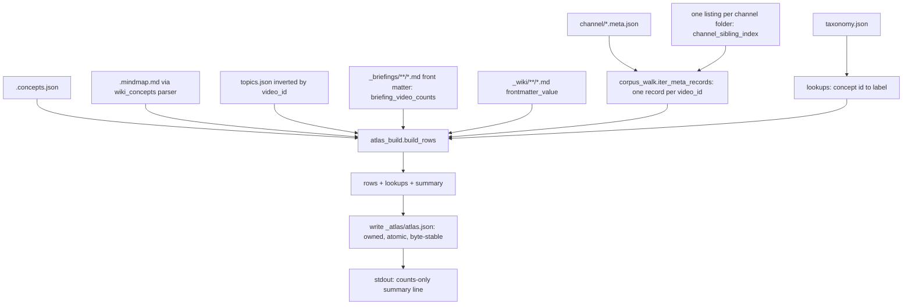

# Atlas Catalog Generator - Plan

## Goal Capsule

- **Objective:** the owner can see, on a phone or a screen and without the CLI, everything that is in the corpus: which creators, which curated threads, which concepts, which videos and other sources, whether each has already flowed through a briefing or a wiki page, and a jump into each video at the right second.
- **Means:** one read-only generator, `scripts/atlas_build.py`, writes one derived catalog file under `<output_dir>/_atlas/` (KTD1); the reader primitives it needs move into a stdlib-only `scripts/corpus_walk.py` that the curate stack also uses (KTD2).
- **Authority hierarchy:** this plan's Requirements own product behaviour; Key Technical Decisions own mechanism; the repo's `CLAUDE.md` Code Review Guardrails and `.claude/rules/intelligence-layer.md` outrank both where they conflict; issue #260 is the origin of scope.
- **Stop conditions:** stop if a required input cannot be read without importing the curate stack (KTD2); stop if the real-corpus summary line does not partition the input (`metas == rows + duplicates + skipped + no_id`, R4).
- **Execution profile:** code, single repo, zero paid API calls, synthetic fixtures only; the real corpus is read once for the smoke in the Verification Contract.
- **Tail ownership:** the implementer opens the PR; the owner runs the real-corpus smoke from the main checkout (the corpus is on a Google Drive mount only that machine has) and pastes the counts-only summary line into the PR.

---

## Product Contract

### Summary

Build the data layer for a visual catalog of the corpus: a generator that reads the artifacts already on disk and writes `_atlas/atlas.json`, one row per video with ids, facets, a heading-only synopsis, labeled timestamp deep links, quality state, and "already seen" signals (briefing membership, wiki pages), complete by design and byte-stable across rebuilds. No renderer, no filtering by audience, no publishing in this plan.

### Problem Frame

The corpus (3,384 metas, 3,331 concept files, 3,332 mindmaps, 1,095 canonical concepts, 36 curated topics, a 53-file wiki) is reachable only through the CLI and Markdown briefings. The reference experience, https://ai.engineer/talks, is a static faceted catalog inlined into a page; every input it needs exists here, scattered across per-video files with no single machine-readable catalog. The owner is the only user: the catalog exists so that nothing that already flowed through the pipeline goes unnoticed, and sources beyond YouTube video are already arriving, so the catalog must show every record it finds rather than only the ones that link to YouTube. Sharing a copy with anyone else is a later, selective act with its own plan (#262). The generator must respect the repo's standing rules (identity by `video_id`, writer's-path, one-definition, best-effort reads, the standalone-script import firebreak).

Measured on 2026-10-28: curated topics cover 984 of 3,384 videos (the largest topic, `ai-engineering`, holds 367); taxonomy `domain` is `ai-engineering` for 3,047 of 3,331 videos; 1,692 metas lack `duration_seconds`; 2,743 videos were published in 2026; `modes_completed` names `mindmap` on 7 metas while 3,332 mindmap files exist; `_wiki/` has creator dossiers and concept pages but no per-video page; two `video_id`s exist in two channel folders each; some rows carry non-YouTube ids and URLs (vendor-portal recordings, a `fathom.video` share link, local-file ingests); 3,338 metas carry a free-text `description`.

### Key Decisions

- **The catalog is complete by design: every record the walker finds is a row, with no filtering by audience, access or source type.** (session-settled: user-directed, chosen over an export policy that drops private-source and non-YouTube rows: the owner is the sole user and will not know what has already flowed through the corpus if the catalog hides it; the policy layer belongs to the day a copy is shared, #262.) Governs R3, R9, R11.
- **Implementation is open source; the corpus, the generated catalog and any real-data screenshot stay private, same status as `config.yaml`.** (session-settled: user-directed.) Governs R14.
- **Transcript text is never in any output; the catalog carries derived material (headings, concept labels, timestamps) and links out to the source.** (session-settled: user-approved, chosen over including transcript excerpts.) Governs R6.
- **Standalone script under the import firebreak, not a `video_intel.py` subcommand.** (session-settled: user-approved, chosen over a subcommand: the subcommand path imports `googleapiclient` at module level and triggers the config-backup classification; `wiki_concepts.py` is the precedent.) Governs R1, R15.
- **One output file.** (session-settled: user-approved, chosen over a second flat `atlas.jsonl` for Apple Embedding Atlas: no renderer has been chosen, and a flat table is a few lines over the catalog once one is.) Governs R12, R13.
- **No content checksums in the header.** (session-settled: user-approved, chosen over a `source_checksum` over every file read: nothing reads it, byte-stable output is already the change signal, and the declared interfaces could not compute it.) Governs R12.
- **This plan is the data layer only.** The renderer bake-off is #261 and sharing is #262. Governs R15.

### Requirements

**Inputs and walking**

- R1. The generator runs as `python scripts/atlas_build.py --corpus <output_dir>` and imports without the curate stack (no `video_intel`, `intel_graph`, `googleapiclient`, `google`, `lancedb`, `voyageai`); PyYAML is imported lazily, inside the briefing front-matter reader only, and `yaml` is absent from `sys.modules` after `import atlas_build`.
- R2. It walks `*.meta.json` files under channel folders only, skipping every `.`- and `_`-prefixed folder, and finds a video's siblings (`.concepts.json`, `.mindmap.md`, `.transcript.md` presence) from one directory listing per channel folder matched by literal prefix, never by rebuilding the prefix from title and date and never by glob.
- R3. It emits exactly one row per `video_id`; when several records share an id, the record with more present mindmap-plus-concepts artifacts wins (the existing two-artifact rule), a tie keeps the first in sorted (channel, filename) order, the losing titles become `aliases`, and the row's `channels` lists every folder the id was found in.
- R4. Input files partition into mutually exclusive counters: `metas` (eligible `*.meta.json` under channel folders), `skipped` (unreadable, not UTF-8 JSON, not a JSON object, over the size cap), `no_id` (a JSON object without a string `video_id`), `duplicates` (extra valid records of an already-seen id), and `excluded_metas` (metas under `.`/`_` folders, not walked); `metas == rows + duplicates + skipped + no_id`; the log names each skipped file on stderr; nothing is quarantined or written back (reading never writes).
- R5. Missing optional inputs degrade with a stable warning code (`taxonomy_missing`, `topics_malformed`, ...) in the summary and a path only on stderr: no `concepts.json` gives an empty concept list, no mindmap gives an empty synopsis and no deep links, an absent or malformed `taxonomy.json` or `topics.json` gives empty labels or topics.

**Row content**

- R6. The synopsis is the ordered list of the mindmap's `##` branch headings, verbatim after control-character and bidi-override stripping and NFC normalization, capped at 200 characters each, and nothing else; the generator never opens a `*.transcript.md` file (presence is a directory-listing fact).
- R7. Deep links are at most three `{label, seconds, url}` entries taken in document order from the mindmap's timestamped leaves, one per branch, distinct seconds, labeled with the branch heading, built only when the row URL is a YouTube URL with an eleven-character id; a branch whose first leaf is past `duration_seconds + timestamp_tolerance(duration_seconds)` uses its next qualifying leaf; no qualifying leaf means no link and never a fabricated timestamp.
- R8. Each row carries `transcript_quality` as one of `severe`, `truncated`, `partial`, `complete`, `skipped`, `unknown`, `none`, decided in exactly this order: a severe flag gives `severe`; status `truncated_output` gives `truncated`; `partial` gives `partial`; `ok` or `complete` gives `complete`; `is_skipped_meta(meta, "transcript")` gives `skipped`; any other present status, or no status with a `.transcript.md` sibling present, gives `unknown`; no status and no sibling gives `none`; plus `transcript_flag_count`. `skip_reason` is never emitted.
- R9. The row `url` is the stored `video_url` when it is a well-formed `https` URL of any host, else JSON `null`; a URL is never built from an id; deep links follow R7.
- R10. The row `channel` is the walker's value: the meta `channel` when it is a non-empty string, else the folder name with a WARNING (the existing `collect_corpus_videos` rule).
- R11. Rows are built by an explicit field projection from meta, never a dict spread; the row keys, in schema order, are `video_id`, `title`, `channel`, `channels`, `published`, `duration_seconds`, `url`, `transcript_quality`, `transcript_flag_count`, `synopsis`, `deep_links`, `concept_ids`, `topics`, `in_briefings`, `briefing_count`, `wiki`, `aliases`; `published` is the first ten characters when they parse as a date, else `""`; `duration_seconds` is an int or `null` (a bool is `null`); `topics` come from `topics.json` only; `wiki` keys follow KTD6; no value contains the corpus root, the temp directory, `My Drive`, or a drive-letter prefix.

**Output**

- R12. `atlas.json` carries, in order, `schema_version`, `generator`, `generator_version`, `generated_from` (the corpus folder name only), `generated_at`, `summary` (channel counts, topic counts, unthreaded count and share, the R4 counters, warning codes), `concepts` (id to label for referenced ids, label falling back to the id), and `rows` sorted by (`published`, `video_id`) with a null-safe sort key; written as UTF-8 bytes with `ensure_ascii=False`, `allow_nan=False`, LF only, one trailing newline; a second run on unchanged inputs produces identical bytes.
- R13. The build writes `_atlas/atlas.json` through a uniquely named temp in the same directory and one `os.replace`; it never overwrites a file whose `generator` header is missing, unreadable, or names a different generator; the stdout line is counts only (no channel, topic, title or path).
- R14. The repo gains `schemas/atlas.schema.json`; `.gitignore` excludes `_atlas/`, `*.zip` and `spikes/atlas/screenshots/`.

**Governance**

- R15. The same PR adds the catalog guardrail entry to `.claude/rules/intelligence-layer.md` and the new paths to the `paths:` of `intelligence-layer.md`, `transcript.md` and `search-index.md`; a routing row to `skills/video-intel/SKILL.md` whose trigger phrases say "catalog", never "atlas" (the Creator Atlas wiki already owns that word); a `docs/atlas.md` page added to `LIVING_DOCS`; `scripts/atlas_build.py` and `scripts/corpus_walk.py` added to `REQUIRED_TRIGGERS["intelligence-layer.md"]`; and `atlas_build` and `corpus_walk` added to the import-isolation test list.

### Success Criteria

- The real-corpus summary line partitions the input per R4, reports `excluded_metas` equal to the metas under `_quarantine/` and `_standalone/`, and reports an unthreaded share (rows with an empty `topics` list divided by rows, rounded to four places) within three points of the 2026-10-28 measurement (about 0.71).
- Every guard is falsified once and the named test fails: the identity tests with a re-copied helper, the transcript-spy test with a transcript read, the reading-never-writes snapshot with a quarantine write, the ownership test with the check removed, the determinism test with the wall clock, the tie-break with `>=`.
- `pytest tests/ --ignore=tests/evals` and `ruff check .` pass; `tests/test_guardrail_inventory.py` and `tests/test_docs_currency.py` pass with the new rule entries and docs.

### Scope Boundaries

- Not in scope: any renderer or page (#261), any filtering of rows or fields by audience, access label or source type (#262), any upload or hosting (#262), a mid-tier theme layer over the 1,095 concepts, importing ai.engineer topic labels (their ToS section 6 question is open), YouTube duration backfill, per-video semantic coordinates.
- Not a goal: a second walker beside `video_intel.collect_corpus_videos`; that function becomes a projection over the new walker (KTD3).

#### Deferred to Follow-Up Work

- **Sharing layer (#262), carrying every review finding from 2026-10-28 so none is lost:** a corpus-side `atlas-policy.yaml` with an access section (per-channel default, per-video override; the earlier user-directed decision against a `config.yaml` field stands) and an export section (default deny; channel, field and topic allowlists; exceptions with a required reason); a pure projection applied once before any writer; a sibling `_atlas-export/` folder; mode-aware ownership and a usage error for `--out` with `--export`; stale-bundle removal on any export failure; canary tests over every output byte; rows from local-file ingests (`transcript_source: "local_file"`) and non-YouTube ids excluded unless named; aliases and `channels` from denied folders treated as policy subjects; a hardened YAML loader (duplicate keys rejected, string-only keys, enum checks); URL canonicalization from the id; `url` and deep links dropped for non-public rows; a real-corpus export smoke; whether the policy fingerprint belongs in the bundle.
- **Renderer inputs (#261):** a flat `atlas.jsonl` if Embedding Atlas is chosen; a gzipped-size measurement of `atlas.json` against a 1 MB threshold before committing to object rows; the plain-text rendering contract (escape headings and titles; `lead_lag_viz.render_html` is the precedent).
- Migrate `wiki_concepts.collect_corpus_videos` (a concepts-first walk with its own `_is_channel_dir` and `_read_json_best_effort`) onto `corpus_walk`.
- Unify `dedupe._pick_canonical` (quality-first, then latest `processed`) with the reader-side two-artifact rule; after `dedupe --apply` only one record remains, so the two agree in steady state.
- Duration backfill via one `videos.list` sweep (about 34 calls).
- `video_intel.load_taxonomy` raises on a corrupt `taxonomy.json`; the catalog reads taxonomy through `corpus_walk` and degrades, the curate path does not.

### Dependencies

- `scripts/timestamp_utils.py` (stdlib-only): `parse_time_to_seconds`, `timestamp_tolerance`, `TIMESTAMP_TOKEN_PATTERN`, and the new `youtube_deep_link` (KTD7).
- `scripts/wiki_concepts.py` (already under the firebreak): `parse_mindmap_timestamps`, `MindmapEntry`, and a new public `mindmap_headings` (KTD7); the catalog never calls its taxonomy reader or its module-global skip tracker.
- PyYAML (already a base dependency) for briefing front matter, lazily imported; `jsonschema` added to the `dev` extra for schema validation in tests, guarded by `importorskip`.

### Sources

- Issue #260 body; `work/2026-10-28/02-...`, `03-...` and `04-...` session notes (local, gitignored) with the Codex review, the measurements and the review round.
- `docs/brainstorms/2026-07-12-kb-browsing-surface-research.md` (wiki as the reading surface; force layouts never the insight surface).
- `.claude/rules/intelligence-layer.md` (`wiki_concepts.py` entry: standalone CLI, foreign-generator refusal, no fabricated timestamps, concept membership from `concepts.json`).
- Apple Embedding Atlas data formats: https://apple.github.io/embedding-atlas/data-formats.html (flat tables only; informs the #261 deferral).
- Frictionless Data Package spec (RFC 3339 `created`, semver `version`).

---

## Planning Contract

### Key Technical Decisions

- KTD1. **Standalone `scripts/atlas_build.py` with `--corpus` (required, resolved, must be a directory), `--out` (default `<corpus>/_atlas`), `--generated-at`, and a public `build_parser()`.** (session-settled: user-approved, chosen over a `video_intel.py` subcommand: the subcommand path imports `googleapiclient` at module level and triggers the config-backup classification; `wiki_concepts.py` is the precedent.) Governs R1.
- KTD2. **Move, never copy, every reader-side decision the catalog consumes into a new stdlib-only `scripts/corpus_walk.py`, re-exported by `video_intel.py` (the #152 pattern).** The move list: the reader-side JSON read extracted from the inline read in `collect_corpus_videos` (bytes, decode, parse, `(ValueError, OSError)`, require a dict, never quarantine; `_read_meta_best_effort` stays in `video_intel`, it is writer-side and quarantines), `usable_video_id`, `is_channel_dir`, the `META_SUFFIX` / `CONCEPTS_SUFFIX` / `MINDMAP_SUFFIX` / `TRANSCRIPT_SUFFIX` constants, `_artifact_count` (the two-artifact winner rule), the four `QUALITY_FLAG_*_SEVERE` constants, `SEVERE_QUALITY_FLAGS` (with `video_intel._SEVERE_QUALITY_FLAGS` kept bound to the same object because `tests/test_timestamp_overrun_flag.py` reads it), `transcript_quality_flags_are_severe`, `_HEALTHY_TRANSCRIPT_STATUSES`, `TRANSCRIPT_STATUS_TRUNCATED`, `is_skipped_meta`, `parse_front_matter` (lazy `import yaml` inside the function), `briefing_video_counts` with `load_seen_video_ids` returning its key set, and `frontmatter_value(text, key)` (generalized from `wiki_concepts._frontmatter_generator`). `normalize_meta_topics` and `normalize_topic_slug` stay in `video_intel` (the catalog never unions meta topics); the mindmap parser stays in `wiki_concepts` (session-settled: user-approved, chosen over moving it: `wiki_concepts` already imports only stdlib modules, so a plain import keeps the diff small). The module logger is `logging.getLogger("video_intel.corpus_walk")` so it inherits `main()`'s level and existing caplog scopes. `video_intel` re-exports through one explicit block; an identity test covers every moved name. No test monkeypatches these names today (checked).
- KTD3. **One walker, agreement by construction.** `corpus_walk.iter_meta_records` returns one record per `video_id` (winner plus losing records) per R3, using the moved `_artifact_count`; `video_intel.collect_corpus_videos` becomes a projection over it that adds the meta-topic union with `video_intel`'s own normalizers and keeps its existing URL fallback for briefings, so briefings, topics-build and the catalog share the identity and tie-break rules. The summary carries the R4 counters; `dedupe`'s different canonical rule is Deferred.
- KTD4. **Determinism with one volatile field.** `generated_at` is `--generated-at` when given, else the maximum of the `processed` values that parse as ISO datetimes (normalized to UTC before the max), else the maximum `published` date, else `null`; never the wall clock. Rows sort by (`published`, `video_id`); keys follow the schema order; text is NFC-normalized before writing. Rationale: `wiki_concepts` and `topics-build` are byte-stable; a wall-clock stamp makes every rebuild a Drive sync diff and breaks the second-run test.
- KTD5. **Object rows with inline lookups.** Rows are objects because 3,400 rows gzip well and objects validate against a schema; the `concepts` lookup is inline and limited to referenced ids; the size measurement that could revisit this belongs to #261 (Deferred).
- KTD6. **Wiki links are page keys resolved from page frontmatter, never re-slugified.** `_wiki/` has two slug rules (`wiki_atlas.slugify` and the order-dependent `wiki_concepts._assign_slugs`), so the catalog scans `_wiki/**/*.md` once with `frontmatter_value` for `creator:`, `concept_id:` (wiki_concepts pages) and `concept:` (wiki_atlas pages) and emits `{"creator": "<channel>", "concepts": ["<concept_id>", ...]}`. A renderer maps keys to files.
- KTD7. **Deep links through one helper, parsing through the existing one.** Add `youtube_deep_link(url, seconds)` to `scripts/timestamp_utils.py` (returns a timestamped URL only for an `https` YouTube host with an eleven-character id, else `None`); switch `wiki_atlas._evidence_citation`'s inline `"youtube.com" in url` check to it in the same diff, which changes one existing wiki test's fixtures and drops timestamps from wiki citations of non-YouTube ids on the next rebuild (an intended change, named in System-Wide Impact). The catalog's selection rule is R7; the briefings' `extract_mindmap_links` and `wiki_concepts.find_timestamp` select differently on purpose; parsing is the shared `parse_mindmap_timestamps`, and the headings come from a new public `wiki_concepts.mindmap_headings` so no private name crosses a module boundary. The strict host set is deliberately narrower than `video_intel._YOUTUBE_HOSTS` (a channel-shape check) and the guardrail entry says so.
- KTD8. **Single-file ownership and atomic write.** Ownership is decided by `atlas.json`'s `generator` key, read fail-closed as `wiki_concepts.write_pages` does: overwrite only on an exact `GENERATOR_NAME` match; refuse when the file is unreadable, not an object, or lacks the key. The output is serialized to `str`, encoded to UTF-8 bytes, written to a uniquely named temp in the target directory (`atlas.json.<pid>.tmp`), then `os.replace`d; any failure removes the temp in `finally`, and a leftover temp matching that exact pattern is removed at the next start. `os.replace` on the Drive mount is best effort (ADR-0016), accepted. Refusal wording follows `write_pages`: "refusing to overwrite {path}: it is {reason}, not {GENERATOR_NAME}".
- KTD9. **Inputs are untrusted text.** Per-file read caps (4 MB meta or concepts, 50 MB taxonomy and topics); every consumed field type-checked (`title` and labels must be `str`, else `""` with a WARNING; `channel` per R10; `published` must match `^\d{4}-\d{2}-\d{2}`); headings, titles and labels stripped of C0/C1 controls and bidi overrides (U+202A-U+202E, U+2066-U+2069), NFC-normalized, `<` and `[...](...)` kept literal; the schema marks these fields plain text and `docs/atlas.md` states that renderers must escape them.

### High-Level Technical Design

Data flow from corpus files to the catalog:



### Output Structure

```text
scripts/
  corpus_walk.py              new: stdlib reader primitives and walker (KTD2, KTD3)
  atlas_build.py              new: the generator (KTD1)
schemas/
  atlas.schema.json           new: JSON Schema 2020-12 for atlas.json
docs/
  atlas.md                    new: what the catalog is, how to build, how to read the summary line
tests/
  test_corpus_walk.py         new
  test_atlas_build.py         new
<output_dir>/_atlas/          generated, never in the repo
  atlas.json
```

### System-Wide Impact

- **Entry points touched by the KTD2 move** (behaviour preserved through re-exports, pinned by identity tests): `briefings --unseen` and `topics-build` (through `collect_corpus_videos` and `load_seen_video_ids`); every transcript writer and `resolve_mindmap_source` (severity and healthy-status set); `missing_pipeline_artifacts` exit codes; `dedupe` (`_dedupe_meta_is_severe`); scan and mark-skip gates (`is_skipped_meta`); `scripts/remediation_restore.py` (calls `vi.transcript_quality_flags_are_severe`); `wiki_concepts` (`frontmatter_value` now imported from `corpus_walk`); `wiki_atlas._evidence_citation` (KTD7).
- **Two intended behaviour changes:** a meta file that parses to a JSON list used to raise `AttributeError` out of `collect_corpus_videos` and kill `briefings` and `topics-build`; it is now skipped and counted, and unreadable metas that used to be skipped silently now log one WARNING each through `video_intel.corpus_walk`. And wiki citations whose URL is not a YouTube URL with an eleven-character id lose their `&t=` link on the next `wiki_atlas` run (KTD7).
- **Data lifecycle on the Drive mount:** `_atlas/` is derived and rebuildable, lives in `output_dir` beside `taxonomy.json` and `topics.json`, never in the repo (R14); byte-stable output (KTD4) keeps unchanged rebuilds from producing sync diffs; a crashed run's temp is removed in `finally` and swept at the next start; stale reads after a write (#67) can only affect the ownership header check, harmlessly.
- **Walkers that must keep ignoring `_atlas/`:** the underscore-prefix rule covers `collect_corpus_videos`, `wiki_concepts`, the `intel_graph` walker and `cmd_repair_metas`; `build_taxonomy`'s `rglob("*.concepts.json")` and the `glob("*/*.meta.json")` call sites stay safe only because `_atlas/` never holds a file ending `.meta.json`, `.concepts.json`, `.mindmap.md` or `.transcript.md`. That is an invariant of this feature: the guardrail entry states it and a test asserts the output file set.
- **Tests that change:** new `tests/test_corpus_walk.py` and `tests/test_atlas_build.py`; `tests/test_timestamp_utils.py` (isolation list, strict-stdlib and module-body AST checks for `corpus_walk`, `youtube_deep_link` cases); `tests/test_briefings.py` (list-top-level meta); `tests/test_wiki_atlas.py` (fixture ids become eleven-character ids plus one non-YouTube case without `&t=`); `tests/test_wiki_concepts.py` (`mindmap_headings` agrees with the parser); `tests/test_guardrail_inventory.py` and `tests/test_docs_currency.py` (new rule paths, `docs/atlas.md`, `REQUIRED_TRIGGERS`). Load-bearing and unchanged: `tests/test_timestamp_overrun_flag.py`, `tests/test_topics.py`, `tests/test_personalization_profile.py`.
- **Not affected:** `CONFIG_BACKUP_COMMANDS` (standalone script), the LanceDB index, the retrieval eval.

### Risks and Mitigations

| Risk | Severity | Mitigation | Owner |
|---|---|---|---|
| The winner rule counts transcripts or sidecars and silently changes which title briefings show | Medium | Winner count is the moved two-artifact rule; a transcript-only tie fixture pins it | R3, KTD3, U6 |
| A missed re-export surfaces as a runtime NameError on a curate path | Medium | Identity test over every moved name; the move-safety test set runs first | KTD2, U1 |
| Free-text meta fields (`description`, `last_error`, `prompt`, `model`, `skip_reason`, ...) reach the catalog | Medium (becomes High the day a copy is shared) | Explicit field projection; a canary test over the row values | R11, U2 |
| Summary line with names or paths pasted into the public PR | Medium | Stdout line is counts only; detail to stderr; docs say paste only the stdout line | R13, U5 |
| Untrusted heading or title text (markup, bidi spoofing) inlined by a renderer later | Low now, Medium at #261 | Strip controls and bidi, NFC, length cap; schema and docs mark fields plain text | KTD9, U2 |
| Oversized or malformed input exhausts memory or crashes the sort | Low | Per-file size caps; type checks; null-safe sort key | KTD9, R4, U2 |
| Drive mount `iterdir` cost | Low | One listing per channel folder, not per meta | R2, U6 |
| The catalog is complete by design, so a copy of `_atlas/` is a copy of everything | Accepted (sole user) | Documented in `docs/atlas.md`; the sharing layer (#262) is the mitigation when a second person gets access | Key Decisions, U4 |

---

## Implementation Units

Execution order: U1, U6, U2, U5, U4. One commit per unit, one PR. (U3, the export policy, was removed from this plan on 2026-10-28 and lives in #262; the U-ID is retired, not reused.)

### U1. Move reader primitives into `scripts/corpus_walk.py` (pure move)

- **Goal:** one stdlib-only home for the primitives the curate stack and the catalog share, with every public name still bound in `video_intel.py`; the suite stays green.
- **Requirements:** R1, R4, R8; KTD2.
- **Dependencies:** none.
- **Files:** `scripts/corpus_walk.py` (new); `scripts/video_intel.py` (re-export block; `collect_corpus_videos` calls the moved reader); `scripts/wiki_concepts.py` (imports `frontmatter_value` from `corpus_walk`; adds public `mindmap_headings`); `tests/test_corpus_walk.py` (new); `tests/test_timestamp_utils.py`; `tests/test_briefings.py`; `tests/test_wiki_concepts.py`; `pyproject.toml` (`corpus_walk` and `atlas_build` in `known-first-party`).
- **Approach:**
  1. Create the module with the KTD2 move list; no walker yet, no new behaviour beyond the dict requirement on the reader.
  2. The reader is extracted from the inline read in `collect_corpus_videos`, not from `_read_meta_best_effort`; an absent optional file is neither counted nor logged, an existing-but-unreadable file is WARNING-logged with its path and appended to the caller's `skipped` list.
  3. `video_intel.py` imports the names in one explicit block and keeps `_SEVERE_QUALITY_FLAGS` bound; `wiki_concepts.py` imports `frontmatter_value` and gains `mindmap_headings` next to `parse_mindmap_timestamps`.
  4. Add `corpus_walk` to the isolation list with the strict-stdlib subprocess check and a module-body AST import check (module-body only, so the lazy `yaml` import is allowed).
- **Patterns to follow:** `scripts/timestamp_utils.py` and its re-export lines (#152); `wiki_concepts._read_json_best_effort` for the error classes.
- **Test scenarios** (`tests/test_corpus_walk.py` unless noted):
  - Identity for every moved name, including `video_intel._SEVERE_QUALITY_FLAGS is corpus_walk.SEVERE_QUALITY_FLAGS` and `video_intel._artifact_count is corpus_walk._artifact_count`.
  - A UTF-8 meta torn mid-character is skipped, appended to the caller's list once, WARNING-logged under `video_intel.corpus_walk`, and no sidecar appears afterwards.
  - A meta whose top level is a JSON list is skipped and counted; in `tests/test_briefings.py`, the same fixture no longer raises from `video_intel.collect_corpus_videos`.
  - A meta whose `video_id` is the integer 123 is counted under `no_id` with a warning naming the file; `"123"` is kept; the two never merge.
  - A directory named `x.meta.json` is skipped as an `OSError`, counted.
  - `frontmatter_value` returns the scalar for `creator:`, `concept_id:` and `concept:` and `None` for a missing key or no front matter.
  - `parse_front_matter` imports `yaml` only when called; `yaml` is absent from `sys.modules` after `import corpus_walk`.
  - In `tests/test_wiki_concepts.py`: `mindmap_headings` and `parse_mindmap_timestamps` report the same heading set on one fixture, and a heading with no bullets appears in `mindmap_headings` only.
  - Isolation: `corpus_walk` imports with the heavy modules blocked, under the strict-stdlib check, and the AST check finds no non-stdlib module-body import.
- **Verification:** the whole suite is green after the move; neutering any re-export line fails the identity test.

### U6. Walker, sibling index and briefing counts in `corpus_walk`

- **Goal:** one identity rule for "one row per video" shared by the catalog, briefings and topics-build, with the Drive mount listed once per channel and the R4 counters a true partition.
- **Requirements:** R2, R3, R4; KTD3.
- **Dependencies:** U1.
- **Files:** `scripts/corpus_walk.py`; `scripts/video_intel.py` (`collect_corpus_videos` becomes a projection over `iter_meta_records`, adding the meta-topic union with its own normalizers and keeping its URL fallback); `tests/test_corpus_walk.py`; `tests/test_topics.py` and `tests/test_briefings.py` (unchanged, load-bearing).
- **Approach:**
  1. `channel_sibling_index(channel_dir) -> dict[prefix, dict[suffix, Path]]` from one `iterdir`, literal `startswith(prefix + ".")`, exact suffix keys so `.meta.corrupt.json` lands under its own key.
  2. `iter_meta_records(corpus, skipped) -> WalkResult` with per-id winner by the moved `_artifact_count` (strict `>`, tie keeps first in sorted (channel, filename) order), the losing records attached, aliases and `channels` collected, and the R4 counters.
  3. `briefing_video_counts(briefings_dir) -> Counter` over `_briefings/**/*.md` front matter (a video listed twice in one file counts once per file); `load_seen_video_ids` returns its key set with the existing `str(v)` coercion byte-identical.
  4. Rewrite `video_intel.collect_corpus_videos` as a projection that adds the meta-topic union; its return shape and URL fallback stay as they are.
- **Patterns to follow:** `wiki_concepts.sibling_artifacts` (literal prefix, never glob), `video_intel.collect_corpus_videos` (artifact-count rule).
- **Test scenarios:**
  - Two metas with one `video_id` under different prefixes yield one record with the richer record's title and the other title in aliases.
  - An equal-artifact-count tie keeps the first in sorted order; flipping `>` to `>=` fails this test; a pair where one record has transcript plus mindmap and the other mindmap plus concepts is decided by the two-artifact count, and counting the transcript fails this test.
  - The same id under two channel folders yields one record whose `channels` lists both.
  - A bracketed prefix finds its mindmap sibling from the index; a `.meta.corrupt.json` sibling is keyed separately.
  - Folders `_wiki`, `_atlas`, `_quarantine`, `_standalone`, `.lancedb` are skipped and their metas counted as `excluded_metas`; an empty channel folder yields nothing; a non-existent corpus returns an empty result.
  - The counters partition: on a fixture with one torn meta, one integer id, one duplicate pair and one excluded folder, `metas == rows + duplicates + skipped + no_id` holds exactly.
  - One `iterdir` per channel folder (spy on `Path.iterdir`), regardless of meta count.
  - `briefing_video_counts` counts a video listed in two briefings as 2 and a video listed twice in one briefing as 1.
  - Agreement: `video_intel.collect_corpus_videos` and `iter_meta_records` on the fixture return the same id set and chosen title per id; `tests/test_topics.py` and `tests/test_briefings.py` stay green.
- **Verification:** the drift between briefings, topics-build and the catalog is structurally impossible (one function); `pytest tests/test_corpus_walk.py tests/test_topics.py tests/test_briefings.py tests/test_transcript_quality_guard.py tests/test_video_id_dedup.py tests/test_chunk_window_mismatch.py tests/test_wiki_concepts.py` passes.

### U2. `scripts/atlas_build.py`: rows, lookups, summary (pure, no writes)

- **Goal:** `build_rows(corpus, skipped) -> BuildResult` with every field per R5-R11 and the summary per R12, nothing written.
- **Requirements:** R5, R6, R7, R8, R9, R10, R11; KTD6, KTD7, KTD9.
- **Dependencies:** U6.
- **Files:** `scripts/atlas_build.py` (new); `scripts/timestamp_utils.py` (`youtube_deep_link`); `scripts/wiki_atlas.py` (`_evidence_citation` switched to it); `tests/test_atlas_build.py` (new, with its own synthetic corpus builder); `tests/test_timestamp_utils.py` (`youtube_deep_link` cases); `tests/test_wiki_atlas.py` (fixture ids and the non-YouTube case).
- **Approach:**
  1. For each record: concept ids from `concepts.json` (type-checked), synopsis from `mindmap_headings` after KTD9 cleaning, deep links per R7 through `youtube_deep_link`, URL per R9, quality per R8 using the sibling index for `.transcript.md` presence, topics from `topics.json` inverted once, briefing fields from `briefing_video_counts`, wiki keys from one `_wiki/**/*.md` frontmatter scan, aliases and `channels` from the walker; explicit projection into the R11 key order.
  2. `lookups.concepts` from `taxonomy.json` for referenced ids (label falls back to the id); `summary` with channel counts, topic counts, unthreaded count and share (`round(unthreaded / rows, 4)`, `null` at zero rows), the R4 counters, warning codes.
  3. Read taxonomy and topics through `corpus_walk`'s reader with the KTD9 caps, never through `wiki_concepts` (its skip tracker is a module global).
- **Patterns to follow:** `wiki_concepts` (caller-visible skip semantics), `wiki_atlas._evidence_citation` (YouTube-only links, now via the shared helper).
- **Test scenarios:**
  - Happy path: four channels, one Cyrillic title, one title containing `/`; every row has the seventeen keys in order; `concepts` holds only referenced ids; the unthreaded share equals the fixture's known value.
  - Synopsis is exactly the `##` headings in order; a transcript sentinel planted in the fixture transcript, a mindmap bullet and `as_mentioned` is absent from every value.
  - Transcript never opened: spy on `Path.read_text`, `Path.read_bytes` and `open`; no `.transcript.md` path is touched; adding a transcript read fails this test.
  - Reading never writes: snapshot the corpus tree (minus `_atlas`) before and after; byte-identical; adding a quarantine write fails this test.
  - Deep links: leaves `(4:05)`, `(4:05)`, `(9:38)` under branch A and `(3:15)` under branch B yield exactly `[{label: "A", seconds: 245}, {label: "B", seconds: 195}]` with URLs ending `&t=245` and `&t=195`; a branch whose first leaf is past `duration + timestamp_tolerance(duration)` uses its next qualifying leaf; no stamps gives `deep_links: []`; a row with a non-YouTube URL gets `deep_links: []`.
  - URL rule: `https://www.youtube.com/watch?v=<11 chars>` and `https://fathom.video/share/x` are kept verbatim; `https://www.youtube.com/watch?v=goldcast-ab12cd34` is kept but gets no deep links; `http://...` and an absent URL give `null`; no URL is ever built from an id.
  - Quality: metas with a severe flag, `truncated_output`, `partial`, `ok`, `complete`, `skip_modes: ["transcript"]`, an unknown literal, no status with a transcript sibling, and no status without one map to `severe`, `truncated`, `partial`, `complete`, `complete`, `skipped`, `unknown`, `unknown`, `none`; `skip_reason` appears nowhere.
  - Channel: a meta with a non-string `channel` gets the folder name with a WARNING; a meta whose `channel` differs from its folder keeps the meta value and lists the folder in `channels`.
  - Wiki keys: pages with `creator: chanA`, `concept_id: x.y` and `concept: x.z` produce the expected keys; no value contains the fixture root, the temp directory, `My Drive` or a drive-letter prefix (the `/` title proves the assertion does not false-fail).
  - Free-text meta fields: canaries in `description`, `last_error`, `prompt`, `model`, `note`, `skip_reason`, `meta_cleanup_note`, `transcript_warning`, `transcript_failover_reason` are absent from rows.
  - Untrusted text: a heading `## Intro <script>x</script> \u202eevil` keeps `<` literal, drops the bidi character, and is capped at 200 characters.
  - Type hardening: `published: 20260101` (int) or `null` builds and sorts first; `duration_seconds: true` becomes `null`; a `concepts.json` with a non-list `concepts`, non-dict entries or a non-string `concept_id` yields an empty list and a warning code; a meta over the size cap is skipped and counted.
  - Missing inputs: no `taxonomy.json` gives `taxonomy_missing` and labels equal to ids; a malformed `topics.json` gives `topics_malformed` and empty topics; a meta-only video still yields a row.
  - In `tests/test_wiki_atlas.py`: eleven-character fixture ids keep `&t=60`; a non-YouTube-shaped id renders without `&t=`.
- **Verification:** `build_rows` on the fixture is pure (no writes), returns the schema key order, and every scenario above is green with its falsification red.

### U5. `scripts/atlas_build.py`: writer, CLI, schema, determinism

- **Goal:** the build end to end: `atlas.json` written atomically and byte-stably, one counts-only line on stdout.
- **Requirements:** R1, R12, R13; KTD1, KTD4, KTD5, KTD8.
- **Dependencies:** U2.
- **Files:** `scripts/atlas_build.py`; `schemas/atlas.schema.json` (new); `tests/test_atlas_build.py`; `tests/test_timestamp_utils.py` (`atlas_build` in the isolation list with a `yaml`-not-imported assertion); `pyproject.toml` (`jsonschema` in `dev`).
- **Approach:**
  1. `GENERATOR_NAME = "atlas_build.py"`, `GENERATOR_VERSION = "1"`, `SCHEMA_VERSION = 1`; header per R12 with `generated_from = corpus.name`.
  2. `write_atlas(out_dir, header, rows, lookups, summary)` per KTD8.
  3. `build_parser()` and `main(argv)` per KTD1; `--corpus` resolved and checked; a leftover temp matching the exact pattern is removed at start.
  4. Stdout line, exactly one: `atlas_build: wrote atlas.json to <corpus.name>/_atlas (metas=N rows=N duplicates=D skipped=S no_id=I excluded_metas=E unthreaded=U (P%) warnings=W)`.
  5. Ship `schemas/atlas.schema.json`; tests validate through `pytest.importorskip("jsonschema")` and a stdlib structural test that always runs (required keys, key order, types), with a non-vacuity case asserting the schema rejects a row missing `video_id`.
- **Patterns to follow:** `wiki_concepts.write_pages` (ownership refusal wording and fail-closed read), `topics-build` (`version`, sorted output, no wall clock), `lead_lag_viz` (`generated` field discipline).
- **Test scenarios:**
  - Caller-level happy path: `main(["--corpus", str(corpus)])` writes the file, exits 0, and the stdout line matches the format with the fixture's counts and partitions (`metas == rows + duplicates + skipped + no_id`); the line contains no fixture channel name, topic slug or path.
  - Determinism: two runs with `--generated-at` fixed are byte-identical; a run without it has `generated_at` equal to the fixture's maximum parseable `processed` normalized to UTC; a fixture with no parseable `processed` falls back to the maximum `published`; stamping the wall clock fails this test.
  - Bytes: `b"\r\n"` is absent; the file ends with exactly one `\n`; `ensure_ascii` is off (a Cyrillic title appears as UTF-8, not `\u` escapes); `allow_nan` rejects a NaN duration before it reaches the file.
  - Ownership: an existing `atlas.json` with `generator: wiki_concepts.py`, an unreadable one, and one that is a JSON list each exit non-zero (assert `exc.value.code`) and leave bytes untouched; removing the check fails these tests.
  - Atomicity: a monkeypatched failure in the serializer leaves the previous file intact and no temp in the directory; a leftover temp matching the pattern is removed at the next start; a file not matching the pattern (the owner's notes) is left alone.
  - Schema: the written file validates; the structural test runs without `jsonschema`; the rejection case is non-vacuous.
  - Output file set: `_atlas/` contains `atlas.json` and never a file ending `.meta.json`, `.concepts.json`, `.mindmap.md` or `.transcript.md`.
  - Isolation: `atlas_build` imports with the heavy modules blocked and `yaml` absent from `sys.modules`.
- **Verification:** a build on the fixture validates against the schema, is byte-stable across two runs, and the stdout line partitions.

### U4. Guardrails, docs, skill parity

- **Goal:** the new surface is documented, routed and governed in the same PR, and the governance claims are tested.
- **Requirements:** R14, R15.
- **Dependencies:** U1, U6, U2, U5.
- **Files:** `.claude/rules/intelligence-layer.md` (new `atlas_build.py` / `corpus_walk.py` entry; `paths:` gains the four new files); `.claude/rules/transcript.md` and `.claude/rules/search-index.md` (`paths:` gain `scripts/corpus_walk.py` and `tests/test_corpus_walk.py`, since the severity rule and the topics join now live there); `skills/video-intel/SKILL.md` (one routing row, curate side, triggers "build the video catalog", "refresh the corpus catalog"; no issue numbers); `docs/atlas.md` (new; opens by distinguishing the catalog from the Creator Atlas wiki); `docs/intelligence-layer.md` and `README.md` (one pointer line each); `tests/test_docs_currency.py` (`docs/atlas.md` in `LIVING_DOCS`); `tests/test_guardrail_inventory.py` (`REQUIRED_TRIGGERS["intelligence-layer.md"]` gains `scripts/atlas_build.py` and `scripts/corpus_walk.py`); `tests/test_atlas_build.py` (docs-flags test); `.gitignore` (R14); `CLAUDE.md` rules-table row wording only if needed.
- **Approach:**
  1. The guardrail entry states the invariants: no transcript file is opened; no fabricated URL or timestamp; one walker (`iter_meta_records`) behind briefings, topics-build and the catalog with the two-artifact winner rule; parsing shared, deep-link selection per surface; the strict YouTube host set is deliberately narrower than `video_intel._YOUTUBE_HOSTS`; `generated_at` never from the wall clock; single-file ownership; `_atlas/` never holds corpus-suffixed files; the catalog is complete by design and the sharing layer is #262; cite `[core: one-definition]`, `[core: writer's-path]`, `[core: real-caller]`, `[core: #124 read-guard]`; no positional phrases.
  2. `docs/atlas.md`: what the catalog is and is not (complete, private, not a sharing format), the build command, how to read the summary line and check the partition, the row schema pointer, the plain-text contract for renderers, the Drive-mount caveat, and the instruction to paste only the stdout line into a PR.
  3. A test extracts every `atlas_build.py` invocation from `docs/atlas.md` and `skills/video-intel/SKILL.md` and asserts each `--flag` exists in `build_parser()`, with a non-vacuity companion asserting at least one invocation was found.
- **Test scenarios:**
  - Dropping `scripts/atlas_build.py` from the rule file's `paths:` fails `tests/test_guardrail_inventory.py`.
  - A documented flag that `build_parser()` lacks fails the docs-flags test; the non-vacuity companion fails when the extractor finds nothing.
  - `tests/test_docs_currency.py` passes with `docs/atlas.md` swept; `git check-ignore _atlas/atlas.json` reports it ignored.
- **Verification:** inventory, currency and docs-flags tests green; reading `scripts/atlas_build.py` in a fresh session loads `intelligence-layer.md`.

---

## Verification Contract

| Check | Command | Applies to |
|---|---|---|
| Move safety (run right after U1 and U6) | `pytest tests/test_corpus_walk.py tests/test_topics.py tests/test_briefings.py tests/test_transcript_quality_guard.py tests/test_video_id_dedup.py tests/test_chunk_window_mismatch.py tests/test_wiki_concepts.py tests/test_wiki_atlas.py` | U1, U6, U2 |
| Unit and integration | `pytest tests/test_corpus_walk.py tests/test_atlas_build.py` | U1, U6, U2, U5 |
| Import firebreak | `pytest tests/test_timestamp_utils.py::TestStandaloneScriptImportIsolation` | U1, U5 |
| Guardrail and docs wiring | `pytest tests/test_guardrail_inventory.py tests/test_docs_currency.py` | U4 |
| Ignore rules | `git check-ignore -v _atlas/atlas.json` reports it ignored | U4 |
| Whole suite | `pytest tests/ --ignore=tests/evals` | all |
| Lint | `ruff format . && ruff check . --fix` | all |
| Real-corpus smoke (owner, main checkout) | `python scripts/atlas_build.py --corpus "G:/My Drive/video-intel"` then paste the one stdout line into the PR; check `metas == rows + duplicates + skipped + no_id`, `excluded_metas` equal to the metas under `_quarantine/` and `_standalone/`, unthreaded share within three points of 0.71 | U5 |
| Retrieval eval | not triggered: no retrieval logic or index is touched | none |

---

## Definition of Done

- All five units merged in one PR against `main`, one commit per unit, with the counts-only summary line from the real-corpus smoke in the description.
- Every guard was falsified once and its named test went red: identity with a re-copied helper, transcript spy with a read, reading-never-writes with a quarantine write, ownership with the check removed, determinism with the wall clock, tie-break with `>=` and with the transcript counted.
- No real corpus data, screenshot or catalog is in the diff; fixtures are synthetic.
- `.gitignore`, the three rule files, the SKILL row, `docs/atlas.md`, `LIVING_DOCS` and `REQUIRED_TRIGGERS` are in the same PR.
- Abandoned experiments and scratch files are removed from the diff.
- Issue #260 is closed by the merge; #261 is unblocked with a comment naming `_atlas/atlas.json` and the plain-text rendering contract; #262 receives the Deferred sharing-layer list as a comment.
