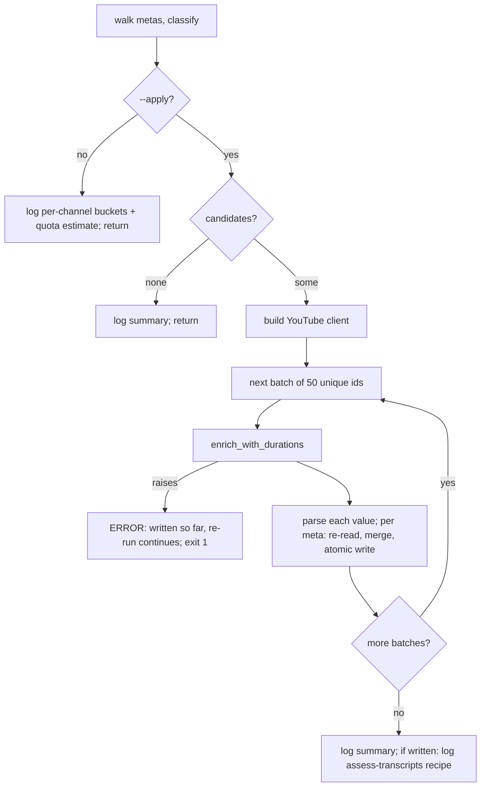

# Backfill Durations Command - Plan

## Goal Capsule

- **Objective:** an operator can fill in the missing video duration on metas already on disk, so the duration-dependent transcript quality checks stop skipping those videos once the transcripts are re-assessed.
- **Means:** a new maintenance command `backfill-durations [--channel X] [--apply]` modeled on `backfill-descriptions` (KTD1).
- **Authority:** the issue #294 contract decisions win over this plan; this plan wins over code habits of neighbouring commands.
- **Stop conditions:** stop and report if the code makes a contract decision impossible (for example `assess-transcripts --force` does not exist, or `enrich_with_durations` cannot be called per batch).
- **Execution profile:** test-first, one new test file, one new command in `scripts/video_intel.py`, docs and one guardrail bullet in the same diff.
- **Tail ownership:** the implementer runs the validation and the Gate 1 smoke; the orchestrator commits.

---

## Product Contract

### Summary

Add `backfill-durations`. It walks every `<output_dir>/<folder>/*.meta.json`, picks metas with a YouTube `video_id` and no usable duration, fetches durations 50 ids per `videos.list(part=contentDetails)` call, and writes only `duration_seconds`. The dry run is the default, makes no API call and leaves every meta byte-identical. After an apply that wrote something, it logs the `assess-transcripts --force` dry run and apply commands.

### Problem Frame

About half the metas have no `duration_seconds`. Every duration-dependent quality check (gap, density, overrun) is skipped for them. Issue #275 persists the duration going forward. Nothing fills the metas already on disk.

### Requirements

**Selection**

- R1. A meta is a candidate when it parses to a non-empty JSON object, `_video_duration_seconds(meta) is None`, and its `video_id` passes `usable_video_id` and `_YOUTUBE_VIDEO_ID_RE.fullmatch`.
- R2. A meta that is unparseable, not an object, or `{}` is counted `unreadable`, never quarantined, never rewritten, in both modes.
- R3. A meta with no usable id, or a non-YouTube id, is counted `no_youtube_id` and never reaches the API.
- R4. A meta that already has a usable duration is counted `has_duration` and is never rewritten.
- R5. `--channel X` narrows the walk to one folder. An unknown folder logs a WARNING and returns without an API call.

**Dry run**

- R6. Without `--apply` the command builds no YouTube client, needs no `YOUTUBE_API_KEY`, and writes no file in any channel folder. (`main()` still takes its config snapshot into `_config-backups/` when the config changed, as for every command in `CONFIG_BACKUP_COMMANDS`.)
- R7. It reports per channel and in total: `has_duration`, `no_youtube_id`, `unreadable`, `candidates`, plus the quota estimate `ceil(unique candidate ids / 50)` units.

**Apply**

- R8. Each unique id is fetched once. Every candidate meta that carries it is written.
- R9. A returned value parsed by `_parse_iso8601_duration` that is a positive int is written as `duration_seconds`. A requested id whose value comes back `None` (no item, or an item without `contentDetails.duration`, per KTD3) is counted `not_found`. A returned string that does not parse to a positive int (for example `P0D`) is counted `no_duration`.
- R10. Immediately before each write the meta is re-read. The write merges only `duration_seconds` into what is on disk then, and goes through `_write_meta_atomic`. A re-read that finds the file gone, an unusable file, a usable duration, or a `video_id` that is no longer the fetched id writes nothing and is counted `changed_since_walk`. A meta is never created.
- R11. A fetch failure stops the run: an ERROR names how many metas were written and says a re-run continues; the exit code is 1. Metas written before the failure stay written.
- R12. After an apply that wrote at least one meta, the command logs two paste-ready commands: `assess-transcripts --force` (dry run), then the same with `--apply --backup-dir <path>`, both carrying `--channel X` when the backfill was narrowed.
- R13. Totals add up: `has_duration + no_youtube_id + unreadable + candidates` equals metas walked, and after an apply that fetched every batch `written + not_found + no_duration + changed_since_walk` equals `candidates` (an R11 abort leaves the unfetched candidates out of every apply bucket).

### Scope Boundaries

- No re-assessment of transcripts, no Gemini; `backfill-durations` itself takes no `--force` flag.
- A `--file` ingest with no YouTube id stays without a duration. A `--file` ingest that resolved a YouTube `video_id` (the 403 recovery recipe) is a candidate like any other meta.
- A meta whose transcript covers only a segment (`transcript --url --start/--end`, or a `--file` run with `segments`) still receives the full-video duration: the field describes the video (issue #275 item 4), and `process --url` with a segment already persists it today. Judging a clipped transcript against the full duration is the assessor's concern; the printed recipe puts the `assess-transcripts --force` dry run first so the operator reviews new severe flags before `--apply`.
- No change to `cmd_assess_transcripts` or its tests (a sibling branch edits it).
- No change to the root `CLAUDE.md` (size budget).

### Deferred to Follow-Up Work

- One recipe pair per written channel instead of one corpus-wide pair: the contract fixes one pair, scoped by `--channel` only when the backfill was narrowed.
- `assess-transcripts` skips `_`/`.` folders, so a meta filled under such a folder is not re-assessed by the printed recipe; the walk still mirrors `backfill-descriptions`.
- A `segments`-aware assessor (or a segment marker on the URL path) so clipped transcripts are judged against their clip, not the video.
- The re-read narrows but cannot close a race with a concurrent curate run on a cloud mount; the docs say to run `--apply` while no scan is active.

---

## Planning Contract

### Key Technical Decisions

- KTD1. **Mirror `cmd_backfill_descriptions`.** Same walk (`sorted(output_dir.glob("*/*.meta.json"))`, `_`- and `.`-prefixed folders included, as that command does), same `--channel` folder check, same YouTube-id predicates (`usable_video_id`, `_YOUTUBE_VIDEO_ID_RE`), same client construction (`YOUTUBE_API_KEY` check, `require_youtube()`), same classification in `CONFIG_BACKUP_COMMANDS`, no `channels:` requirement.
- KTD2. **One definition of "missing" is `_video_duration_seconds(meta) is None`.** It is applied to the parsed meta dict. A meta carrying only a parseable `duration_iso` therefore counts as having a duration; no writer persists that key today.
- KTD3. **Fetch per batch through `enrich_with_durations`.** Call it once per 50 unique ids, then write that batch before fetching the next. This keeps one API call per batch, reuses the existing call site, and makes "written before the failure stays written" true. `enrich_with_durations` maps an absent item and an item without `contentDetails.duration` both to `None`; both count as `not_found`.
- KTD4. **A local strict reader, no quarantine.** The walk and the write-time re-read parse `read_bytes()` with `json.loads(... .decode("utf-8"))`, catching `ValueError` (covers `UnicodeDecodeError`, issue #124). An `OSError` propagates, except a `FileNotFoundError` at the write-time re-read, which means the meta is gone and counts `changed_since_walk` (R10). `_read_meta_best_effort` is not used, because it quarantines unusable content, which breaks the byte-identical dry run. One small helper serves both reads so the walk and the re-read agree.
- KTD5. **Write through `_write_meta_atomic`.** It already writes `json.dumps(meta, indent=2)` to `<meta>.<pid>.tmp` and `os.replace`s it, the same indent and ASCII escaping every meta writer uses. The merged dict keeps key order, so a meta written by the pipeline changes only by the added key. Never `update_meta`.
- KTD6. **Backup path in the printed recipe.** The apply command names `<output_dir>/_meta-backups/assess-transcripts-<YYYYMMDDTHHMMSSZ>` (UTC, the stamp style the scan already uses), an `_`-prefixed folder like `_config-backups`, so corpus walkers skip it. The strings are rendered from argv lists, with path arguments in double quotes as `log_scan_index_recipe` does (the live corpus path can contain a space). A test whose output folder name contains a space splits the logged lines with `shlex.split` and feeds them back through the real parser.
- KTD7. **Logging, not print.** The per-channel summary, totals and recipe go through `log.info`, matching `backfill-descriptions` and `log_scan_index_recipe`.

### High-Level Technical Design

### Assumptions

- The per-channel line and the totals line are the dry-run "summary"; their exact wording is an implementation detail.
- An `OSError` on a meta read aborts the run (it propagates), as in `assess-transcripts`. In apply mode, metas written before it stay written.

---

## Implementation Units

### U1. The `backfill-durations` command

- **Goal:** R1 to R13 in `scripts/video_intel.py`.
- **Requirements:** R1-R13, KTD1-KTD7.
- **Dependencies:** none.
- **Files:** `scripts/video_intel.py`, `tests/test_backfill_durations.py`.
- **Approach:**
  1. Add the strict read helper (KTD4) and `cmd_backfill_durations` next to `cmd_backfill_descriptions`.
  2. Add the argparse entry after `backfill-descriptions`, the dispatch branch, and `"backfill-durations"` in `CONFIG_BACKUP_COMMANDS`.
  3. Add a small function that builds the two next-step argv lists, used by the logger and by the parse test.
- **Execution note:** test-first; drive the real `cmd_backfill_durations` with only the YouTube client stubbed.
- **Patterns to follow:** `cmd_backfill_descriptions`, `cmd_assess_transcripts` (strict read, atomic write), `tests/test_video_description.py::TestBackfill` (fake client), `tests/test_assess_transcripts.py::TestParserContract` (driving `main`).
- **Test scenarios:**
  - Apply fills a candidate; the full dict before and after differ only by `duration_seconds`, and `read_text()` equals `json.dumps(before + key, indent=2)` (text mode, so Windows line endings do not matter).
  - Dry run with a candidate and a corrupt meta present: every file's bytes unchanged, no `.corrupt` sidecar, the client factory never called, no key in the environment.
  - Dry run reports candidates per channel and the quota estimate (51 unique ids reads 2 units).
  - A meta with no `video_id`, a non-string id and a non-YouTube id are counted `no_youtube_id` and never fetched.
  - A meta with a positive `duration_seconds` is never fetched or rewritten; one with `0`, `true` or a string is a candidate.
  - Buckets after apply: `written`, `not_found` (no item), `no_duration` (item with `P0D` or garbage), and the two totals identities hold.
  - `--channel` narrows the walk; an unknown channel makes no call and returns.
  - 51 candidates make exactly two `videos.list` calls of 50 and 1 ids.
  - Two metas sharing an id (two folders) produce one fetched id and two writes.
  - The second batch raises: exit code is 1 (asserted as a code), batch-one metas are written, the ERROR names the count, and a re-run fetches only the remainder.
  - A meta that gains a duration between the walk and the write keeps the on-disk value and is counted `changed_since_walk`.
  - A meta deleted between the walk and the write is not recreated and is counted `changed_since_walk`.
  - A `transcript_source: local_file` meta carrying an 11-character YouTube id is filled.
  - No `*.tmp` file remains after apply.
  - The logged next-step lines, split and fed to the real `main` parser with `cmd_assess_transcripts` stubbed, parse; the stub sees `force=True`, and `apply=True` with a backup dir for the second line.
  - `backfill-durations` is in `CONFIG_BACKUP_COMMANDS` and `main` dispatches it without `channels:`.
- **Verification:** the new tests pass, each guard falsified once (candidate predicate, no client in dry run, only one key, the re-read, the exit code).

### U2. Docs and guardrail

- **Goal:** skill parity and the review guardrail in the same diff.
- **Requirements:** R6-R12 documentation.
- **Dependencies:** U1.
- **Files:** `skills/video-intel/SKILL.md`, `README.md`, `docs/meta-json-schema.md`, `docs/troubleshooting.md`, `.claude/rules/scan-config.md`.
- **Approach:**
  1. SKILL.md: a routing row after `backfill-descriptions` and trigger phrases in the frontmatter `description` ("fill in missing video durations", "backfill durations", "why are so many transcripts not assessed"). Timeless wording, no issue numbers.
  2. README: two lines after the `backfill-descriptions` example, with a neutral channel name.
  3. Schema: add `backfill-durations` to the `duration_seconds` "written by" cell.
  4. Troubleshooting: one row for "quality checks skipped because the duration is unknown".
  5. scan-config.md: one bullet placed directly after the issue #275 bullet, leaving every existing bullet untouched.
- **Test scenarios:** Test expectation: covered by `tests/test_skill_descriptions.py`, `tests/test_docs_currency.py`, `tests/test_guardrail_inventory.py`, `tests/test_config_backup.py` staying green.
- **Verification:** those suites pass; no new phrase collides with the search skill's triggers.

---

## Verification Contract

| Gate | Command | Pass |
|---|---|---|
| Format | `ruff format <changed files>` then `ruff format --check .` | exit 0 |
| Lint | `ruff check scripts tests` | exit 0 |
| New tests | `python -m pytest tests/test_backfill_durations.py -q` | all pass |
| Suite | `python -m pytest tests/ -q --ignore=tests/evals -p no:cacheprovider` | all pass |
| Gate 1 smoke | assert no `config.yaml` exists in the worktree (it would beat the env var) and that the log names `VIDEO_INTEL_OUTPUT_DIR` as the config source; then the real CLI against a scratch copy, `VIDEO_INTEL_OUTPUT_DIR` set, dry run without `YOUTUBE_API_KEY`, then `--apply` (one `videos.list` call), then the dry run again | candidates drop to the not-found and no-duration remainder; two metas differ only by `duration_seconds` |

---

## Definition of Done

- U1 and U2 complete, every scenario in U1 has a test, each listed guard falsified.
- Validation table green, Gate 1 smoke run and reported.
- No edits to `cmd_assess_transcripts`, its tests, or the root `CLAUDE.md`; no abandoned code left in the diff.
