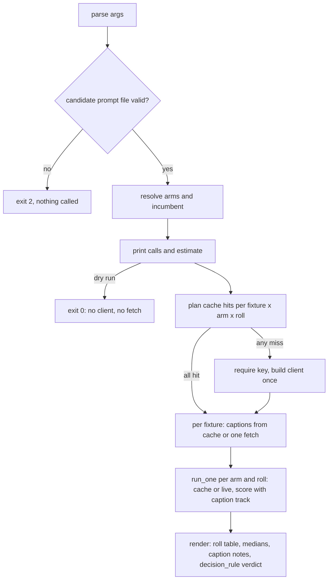

# Model Eval Benchmark - Plan

## Goal Capsule

- **Objective:** when a new Gemini model or a candidate transcript prompt arrives, the operator runs one command and reads a verdict that says PASS, FAIL or NOT EVALUATED per written rule, instead of gathering rolls by hand and judging them afresh.
- **Means:** extend `scripts/model_eval.py` in place (one harness, not two) with rolls, hard fails, a caption-offset metric, a prompt arm and one decision-rule function (KTD1-KTD12).
- **Authority:** issue #292 (scope, constraints, acceptance), then the ticket contract decisions 1-9, then `.claude/rules/evals.md`, `.claude/rules/transcript.md` (issues #231 and #289 entries), root `CLAUDE.md`, then this plan.
- **Stop conditions:** stop and report if `caption_align.entry_offsets` cannot serve the metric without editing `scripts/caption_align.py`, if a contract decision proves impossible in the code, or if an existing test would have to change to pass (adding the runbook to `LIVING_DOCS` in `tests/test_docs_currency.py` is the one planned exception).
- **Execution profile:** test-first, no network of any kind (no Gemini, no caption fetch, no YouTube API), no edit under `prompts/`, no change to `DEFAULT_MODEL`.
- **Tail ownership:** the orchestrator commits and opens the PR; it is not merged until reviewed.

---

## Product Contract

### Summary

`model_eval.py` gains `--rolls N`, per-roll hard-fail detection, a cue-level timestamp-offset metric against the caption track, a `--candidate-prompt PATH` arm, and a decision rule printed per rule in the scorecard. The dry run states the cost of every arm and roll and calls nothing. A one-page runbook tells the operator what to run and what to read.

### Problem Frame

The `gemini-3.8-flash` evaluation (issue #219) reached a sound decision, but its evidence was assembled by hand: repeat rolls typed into a table, a dropped-task roll noticed by eye, and timestamp accuracy listed as not measured. The next model or prompt candidate (issues #291 and #296 depend on this) would repeat that research project. The harness also cannot compare two prompts at all.

### Requirements

**Rolls and caching**

- R1. `--rolls N` (integer, at least 1, default 1) runs every (fixture x arm) cell N times, and the card reports per metric the median and the spread (max minus min over the rolls that produced a value); one roll gives spread `None`, never `0`.
- R2. The roll table in the card is generated from the stored cells, one line per roll.
- R3. The raw-response cache key covers model, fixture identity and window, prompt content hash, thinking level and roll index; a cell is never rescored from an entry made under a different key.
- R4. A roll whose generation failed is a recorded, counted row; it is never dropped from the counts the medians are reported against.

**Hard fails**

- R5. A roll is a hard fail when, after `try_parse_transcript_json` (the production parse path), the response is not the transcript envelope, or lacks the `speakers` or `screen_content` task while the fixture expects it (`expects_speakers` / `expects_screen`, both default true).
- R6. Each hard fail is shown on its roll's line and named in the verdict.

**Timestamp accuracy**

- R7. Per cell the card reports the median and the 90th percentile of the absolute offset between each dialogue entry's stamp and the start of the caption cue holding its first words, computed only through `caption_align.entry_offsets`, cue-level and stated as such.
- R8. Unaligned entries are counted and excluded; with fewer than 5 aligned entries the metric is `None` ("not measured").
- R9. Captions come only through `fetch_english_captions`, once per fixture, cached under the gitignored `_raw/` folder; a refused, absent or failed fetch makes the metric `None` with its reason in the card and never fails the run.
- R10. For a windowed fixture only cues whose start lies inside the window are used.

**Prompt arm**

- R11. `--candidate-prompt PATH` adds an arm for the candidate model; PATH must be an existing readable file, checked before any call.
- R12. Arms are keyed by (model, prompt label), the label being `bundled` or `candidate:<first 8 hex of sha256>`; the card records each arm's full hash and the prompt it really used, including an issue #221 override.

**Decision rule**

- R13. One function in the scorecard generator returns, per candidate arm against the incumbent arm, per fixture and overall, a verdict for each decision rule. The plan calls them D1-D4; the card labels them R1-R4 as the ticket does:
  - D1: no hard fail in any roll of the candidate.
  - D2: the candidate's median `max_gap_s` is no worse than the incumbent median by more than the incumbent's spread.
  - D3: the same comparison for the median caption offset.
  - D4: a cost figure exists for the candidate arm.
- R14. D2 or D3 is NOT EVALUATED, never PASS, when the incumbent has fewer than 2 contributing rolls (spread unknown) or either side's median is `None`. D4 with no cost figure is FAIL, because absence is what it tests. Overall is PASS only when every rule is PASS on every fixture; otherwise it is FAIL when any rule is FAIL, else NOT EVALUATED.
- R15. `--incumbent` accepts a model name or `bundled` (the candidate model's bundled-prompt arm) and defaults to `DEFAULT_MODEL` with the bundled prompt.
- R16. A cell's `model_served` (issue #295) is shown on its roll line, and the verdict names it when it differs from the requested model.

**Dry run, compatibility, docs**

- R17. `--dry-run` prints a cost estimate that scales with fixtures x arms x rolls and constructs no Gemini client and fetches no captions.
- R18. Cached cells and rows written before this change load, score and render as one roll; their offsets are computed when the fixture's caption track is available and are `None` with a reason otherwise.
- R19. `docs/model-benchmark-runbook.md` (linked from `docs/testing.md` and the `.claude/rules/evals.md` entry) gives the two recipes, the rule in plain words, each NOT EVALUATED and its remedy, the cost line, and what is not measured; its commands parse under the real argparse.

### Scope Boundaries

- No edit under `prompts/`, no change to `DEFAULT_MODEL` or any model choice, no paid or network call in tests or Gate 1.
- `scripts/caption_align.py`, `tests/test_caption_align.py`, `tests/test_repair_timestamps.py` and the issue #289 repair code in `scripts/video_intel.py` are read-only.
- The fixture manifest gains exactly the two optional keys the contract names, `expects_speakers` and `expects_screen` (default true); the committed template shows them as comments. No new CLI flag selects a manifest: tests point the module at a synthetic manifest under `tmp_path`.

#### Deferred to Follow-Up Work

- A `README.md` pointer to the runbook (README line 325 still describes hand-rolled rolls); the contract lists only the runbook, `docs/testing.md` and the rule file.
- The editable block in `prompts/transcript.md` for issue #291 belongs to #291.
- `tests/test_model_eval_window_fidelity.py::TestTheCachedRealRunsAllPass` globs every `_raw/*.usage.json` as known-good; once a real benchmark writes roll and prompt-arm cells there, a legitimately window-missed cell turns it red on the operator's machine. Scoping that test to its original cells changes an existing test, so it is a follow-up.
- A minimum aligned share for the offset metric (aligned over dialogue entries) would stop D3 describing a minority of a transcript; the roll table shows the counts, but the threshold is an unmeasured choice.

### Open Questions

- Deferred, non-blocking: D2/D3 use the incumbent's full range (max minus min) as the tolerance, as issue #292 and the contract specify. A single collapsed incumbent roll widens that band a lot, and a range only grows with more rolls; a robust spread (median absolute deviation) would be stricter. Changing it reopens a fixed decision, so it is recorded here, not built.

---

## Planning Contract

### Key Technical Decisions

- KTD1. **One row per roll.** Each roll is one row dict carrying `roll` and `prompt_label`; a row missing them reads as roll 1 of `bundled`. Rows stay a flat list, so the JSON sidecar keeps the shape `tests/test_model_scorecard_gate.py` reads.
- KTD2. **Cache stem and key.** Roll 1 of the bundled arm keeps the existing stem `<fixture>__<model>`, so existing caches and `tests/test_served_model.py` keep working; every other cell uses `<fixture>__<model>__<label>__r<N>` with `:` replaced by `-`. The full key dict is stored inside the `.usage.json` under one private field. A stored key that differs from the current one is a miss and the cell runs live (stale entries are overwritten). An entry with no stored key is legacy: it is accepted only on the roll-1 bundled stem and the row is marked `cache: legacy`, and the card says its prompt, window and thinking level are unverified. Thinking level is in the key because it changes the response; the key stores the `--thinking` value, else the `DEFAULT_THINKING` entry, else the literal `helper-default` (the helper's choice depends only on the model, which is already in the key), so the key is computable without importing the SDK. One lookup helper serves both `main`'s hit planning and `run_one`, so the two cannot disagree [core: writer's-path].
- KTD3. **One hard-fail classifier.** `hard_fails(row, fixture)` returns the list of named fails (`generation_failed`, `not_envelope`, `missing_speakers`, `missing_screen_content`) from row fields that `score()` already computes from its single parse, plus a new `envelope_ok` field. `envelope_ok` is computed on the unwrapped envelope `score()` already builds (`parsed[0]` for a list-wrapped response, as `merge_transcript_json` does), and is true when it is a dict holding a `transcripts` list. A row without `envelope_ok` (written before this change) yields no `not_envelope`, mirroring `cell_measured_its_window`. Both the roll table and the decision rule call it. A missing task and an empty task list are the same fail, because the production wrapper normalization turns a missing task into `[]`.
- KTD4. **A failed generation is a hard fail.** No response is "not the transcript envelope at all"; counting it under D1 keeps a failure from making a candidate look better (the issue #228 lesson in `.claude/rules/evals.md`). The D1 detail names the error class, and the runbook says a FAIL caused only by transport errors means re-run.
- KTD5. **Offset metric inside `score()`.** `score()` takes an optional caption track and computes offsets from the envelope it already parsed: dialogue entries are `transcripts` items with a parseable stamp and text, read as absolute video time (the same reading the issue #219 window check uses). It calls `caption_align.entry_offsets` through the module attribute, never a copy. Median is `statistics.median` and p90 is nearest-rank (always an observed value) of the absolute offsets. `OFFSET_MIN_ALIGNED_ENTRIES = 5`.
- KTD6. **Caption fetch.** Once per fixture, before its cells: read `_raw/<fixture>__captions.json` when its stored video id matches; otherwise call `v.fetch_english_captions(video_id, reason_sink=<fresh dict>)` and adapt with `v.caption_cues_from_captions` (the issue #289 adapter). Only a successful track is cached. A refusal (classified by `captions_failure_is_refusal`), an absence, a missing video id or any exception yields a `None` metric with a reason string. The video id comes from the fixture URL with the identity readers' 11-character pattern; no shared helper exists in `video_intel.py`. A URL without an id gives `None` with that reason.
- KTD7. **Arms and incumbent.** Models are the candidate plus the incumbent model when it differs. Arms are each model's `bundled` arm plus `(candidate, candidate:<hash8>)` when `--candidate-prompt` is given. `--incumbent bundled` selects `(candidate, bundled)`; a model name selects `(name, bundled)`; omitted selects `(DEFAULT_MODEL, bundled)`. This adds the default model's arm to a run that names no incumbent, and the dry run prices it. When no arm differs from the incumbent arm (for example `--candidate <DEFAULT_MODEL>` alone, the command the scorecard gate prints), the run still scores and renders and the decision block says there is no candidate arm to compare. The candidate-prompt arm's rows carry `prompt_override: None`; the prompts-per-arm section names what each arm used.
- KTD8. **One decision function.** `decision_rule(rows, manifest, incumbent_arm)` returns per candidate arm a per-fixture and overall verdict for D1-D4 with a detail string each. Combine order: FAIL beats NOT EVALUATED beats PASS. The D2 and D3 inputs are the contributing rolls: a roll contributes when it did not fail, has a value, is not `cache: legacy`, and has `window_exceeded` not `True` (the existing verdict already excludes window-missed cells, issue #219). Every dropped roll is counted in the detail. D2 or D3 is NOT EVALUATED when the incumbent has fewer than 2 contributing rolls, or when any non-failed candidate roll did not contribute, so a dropped bad roll can never flatter the candidate. D2 and D3 are also NOT EVALUATED when the two arms request different models but every known served name on both sides is the same one model (issue #295): the run then measured one model against itself. D1 counts every roll, legacy and window-missed included, and its detail shows the incumbent's hard-fail count beside the candidate's. The card prints both arms' median `$/vid-hr` beside the verdict, because D4 checks only that cost exists.
- KTD9. **Lazy client.** `main` first decides which cells are cache hits; only when a live call is needed does it require `GEMINI_API_KEY` and construct the client, once, before any caption fetch or call. A full cache replay needs no key and no client.
- KTD10. **Dry-run estimate.** `estimate_cost(...)` prices each arm as fixtures x rolls x segment minutes at the transcript rates measured in `docs/cost-model.md` (about 5,500 input and 450 output tokens per video-minute at low media resolution) times the model's `PRICING`; a model without pricing reports unknown. The line says it is an estimate from average measured rates that ignores cached cells, and that output-heavy models can exceed it.
- KTD11. **Testable CLI.** Split `build_parser()` out of `main(argv=None)` so the runbook test drives the real parser; `--rolls` uses a type function rejecting values below 1. The candidate-prompt file is checked inside `main`, not in an argparse type, so the runbook's placeholder paths still parse.
- KTD12. **The existing mean line stays bundled-only.** The kept "mean max_gap" verdict line and its exclusion note compare bundled arms only (rows whose `prompt_label` is `bundled` or absent) and print only when the incumbent arm is another model's bundled arm. Arm-level comparison lives only in the decision block, so a prompt run never averages two prompts into one figure.

### High-Level Technical Design

Directional flow of one run:

### Assumptions

- The model returns absolute video-time stamps for a clipped window; when it does not, the issue #219 `window_exceeded` flag already marks the cell and KTD8 drops it from D2 and D3.
- `docs/cost-model.md` per-minute token rates are close enough for an estimate across Flash models.

---

## Implementation Units

### U1. CLI, arms and dry-run estimate

- **Goal:** the parser, arm resolution, prompt validation and dry-run estimate exist and call nothing.
- **Requirements:** R1 (flag), R11, R12 (labels), R15, R17.
- **Dependencies:** none.
- **Files:** `scripts/model_eval.py`, `tests/test_model_eval_benchmark.py`.
- **Approach:** KTD7, KTD10, KTD11. Prompt validation runs before the dry-run branch.
- **Test scenarios:**
  - `--rolls 0` and `--rolls -1` are rejected by the parser.
  - Arms for `--candidate A --incumbent B` are two bundled arms; with `--candidate-prompt` a third arm labelled `candidate:<hash8>`; `--incumbent bundled` selects the candidate's bundled arm; omitted selects `DEFAULT_MODEL`.
  - A missing `--candidate-prompt` file exits non-zero and neither the client factory nor the caption fetcher is called.
  - Dry run with `--rolls 3` prints three times the one-roll estimate and the call count fixtures x arms x rolls; a candidate prompt adds one arm's cost.
  - Dry run never calls `create_client` or `fetch_english_captions` (spies that record calls).
- **Verification:** the dry-run tests pass with both spies empty.

### U2. Rolls and the cache key

- **Goal:** `run_one` runs one roll of one arm against a keyed cache, and `main` builds the client only when needed.
- **Requirements:** R1, R3, R4, R18.
- **Dependencies:** U1.
- **Files:** `scripts/model_eval.py`, `tests/test_model_eval_benchmark.py`.
- **Approach:** KTD1, KTD2, KTD9. `run_one` keeps its positional signature and gains keyword `roll`, `prompt` and `caption_track`; omitted, it behaves as roll 1 of the bundled arm.
- **Patterns to follow:** the existing `run_one` cache read/write and the issue #295 served-model capture.
- **Test scenarios:**
  - Two prompts for the same model, two models, and two rolls each get distinct cache files and a cell is never served another key's entry.
  - A stored key whose prompt hash differs is a miss: the stub is called and the file is overwritten.
  - A legacy entry with no stored key replays as roll 1 of `bundled`, marked `cache: legacy`, with no call.
  - A raising generation records an `error` row carrying `roll` and `prompt_label`.
  - A full-cache replay through `main` needs no `GEMINI_API_KEY` and never calls `create_client`.
- **Verification:** `tests/test_served_model.py::TestModelEvalScorecard` stays green unchanged.

### U3. Hard fails and the caption-offset metric

- **Goal:** each roll carries its hard fails and its caption offsets.
- **Requirements:** R5, R7, R8, R9, R10.
- **Dependencies:** U2.
- **Files:** `scripts/model_eval.py`, `tests/test_model_eval_benchmark.py`.
- **Approach:** KTD3, KTD4, KTD5, KTD6.
- **Test scenarios:**
  - Not an envelope (unparseable text, a dict without `transcripts`) is `not_envelope`.
  - A list-wrapped envelope with all three tasks has no hard fail and keeps `envelope_shape: list-wrapped`.
  - A legacy cache entry scored with a stubbed caption track gets computed offsets.
  - No `speakers` entries is `missing_speakers`; no `screen_content` entries is `missing_screen_content`; the same payload has no hard fail when the fixture sets the expectation false.
  - A task-wrapper response that omits one task goes through the production normalization and reports that task missing.
  - A synthetic transcript plus caption track with known shifts gives the hand-computed median and nearest-rank p90.
  - Four aligned entries give `None` with the aligned and unaligned counts recorded.
  - A refused track (reason sink kind `blocked`), an absent track, and a raising fetcher each give `None` with a reason and the run completes.
  - Cues outside the window are not passed to the aligner.
  - Monkeypatching `caption_align.entry_offsets` proves `score()` calls it.
  - An AST walk finds no `difflib` import and no definition of the aligner's function names in `model_eval.py`; the same walk run on `caption_align.py` finds them (non-vacuity), and finds the `caption_align.entry_offsets` reference in `model_eval.py`.
  - Captions are fetched once per fixture across arms and rolls and replayed from the `_raw/` cache on a second run.
- **Verification:** every scenario passes with no network.

### U4. Card rendering and the decision rule

- **Goal:** the card shows every roll, medians with spreads, caption notes, and the verdict per rule.
- **Requirements:** R2, R4, R6, R12, R13, R14, R16, R18.
- **Dependencies:** U3.
- **Files:** `scripts/model_eval.py`, `tests/test_model_eval_benchmark.py`.
- **Approach:** KTD8, KTD12. `render` keeps its signature; `incumbent` may be a model name (bundled arm) or an arm tuple. The existing table, the window column, the served-model rendering, the "mean max_gap" verdict line and the exclusion note stay; added are prompt and roll columns, offset columns, a hard-fail column, a medians table, caption notes, a prompts-per-arm section and the decision block. "Not measured here" states the roll count and that offsets are cue-level.
- **Test scenarios:**
  - Medians and spreads for three rolls; one roll shows spread `None` rendered as `-`.
  - A failed roll appears in the roll table and in the roll counts.
  - PASS path: no hard fail, medians within the incumbent spread, offsets within spread, cost present.
  - Each FAIL path alone: a hard fail in one roll (D1), median `max_gap_s` beyond spread (D2), median offset beyond spread (D3), no cost figure (D4).
  - Each NOT EVALUATED path: one incumbent roll, a `None` offset on either side, no incumbent cells for the fixture, a candidate roll dropped for a missed window, a legacy incumbent roll that would otherwise widen the spread, and two requested models served by one model; overall is then not PASS.
  - With no arm distinct from the incumbent, the card renders and says there is no candidate arm.
  - A prompt run's mean line does not average the two prompt arms.
  - The verdict names a served model that differs and a hard fail by name.
  - Legacy rows (no `roll`, no offsets, no `envelope_ok`) render with no hard fail, D1 not FAIL, and D2/D3 NOT EVALUATED.
- **Verification:** `tests/test_model_eval_window_fidelity.py` and `tests/test_served_model.py` pass unchanged.

### U5. Runbook and rule entry

- **Goal:** the operator can follow one page; reviewers have the invariants.
- **Requirements:** R19.
- **Dependencies:** U4.
- **Files:** `docs/model-benchmark-runbook.md`, `docs/testing.md`, `.claude/rules/evals.md`, `tests/evals/model_fixtures.yaml.example` (the two `expects_*` keys as comments), `tests/test_docs_currency.py` (add the runbook to `LIVING_DOCS`), `tests/test_model_eval_benchmark.py`.
- **Approach:** the rule entry follows the house style and cites `[core: one-definition]`, `[core: probe-before-pay]` and `[core: real-caller]`; the runbook names no superseded model and no corpus figure. The runbook also names the two fixture keys (set `expects_screen: false` on low-screen fixtures before a first run), says a transport-error-only FAIL means re-run, and says PASS does not compare cost or text completeness.
- **Test scenarios:**
  - Every `python scripts/model_eval.py ...` line in the runbook parses under `build_parser()`, with a companion asserting at least two such lines were found.
- **Verification:** `tests/test_docs_currency.py` and `tests/test_guardrail_inventory.py` stay green.

---

## Verification Contract

| Gate | Command | Pass |
|---|---|---|
| Format | `ruff format --check .` | exit 0 |
| Lint | `ruff check scripts tests` | exit 0 |
| Suite | `python -m pytest tests/ -q --ignore=tests/evals -p no:cacheprovider` | all pass |
| Gate 1a | real CLI `--dry-run --rolls 3` from a PRE tree (origin/main) and a POST tree copy | PRE rejects `--rolls`; POST estimate is 3x the one-roll estimate; spies show no client and no fetch |
| Gate 1b | offline replay: `main(argv)` from a scratch tree over a scratch copy of the gitignored `_raw/` cache, with `GEMINI_API_KEY`/`GOOGLE_API_KEY` removed, `create_client` and `fetch_english_captions` patched to raise, and `--out` in scratch | card renders, one roll per cell, `None` offsets with the fetch-failed reason, D2/D3 NOT EVALUATED, nothing called |

Each new guard test is falsified by neutering its production change and confirming exactly its tests fail.

## Definition of Done

- Every requirement R1-R19 has a passing test in `tests/test_model_eval_benchmark.py` or is shown by a gate above.
- Existing tests pass without edits, except the `LIVING_DOCS` addition.
- No file under `prompts/`, no issue #289 file and no `config.yaml` is touched.
- No dead experimental code remains in the diff.
